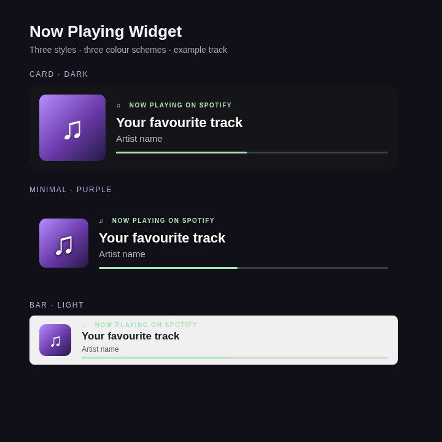

# Now Playing Widget

Self-hosted, multi-user Spotify now-playing widget for OBS. Each user signs in with Spotify, picks a style and colour scheme, and receives a private browser-source URL. Playback pauses hide the widget. The widget polls Spotify every 10 seconds. YouTube Music is not supported in this first version.

## Preview

Styles and colour schemes can be combined in the dashboard. The image uses sample track information.

## Setup

1. Create an app in the [Spotify Developer Dashboard](https://developer.spotify.com/dashboard). Set its redirect URI to `https://YOUR-DOMAIN/callback` exactly.
2. Copy `.env.example` to `.env`. Set `BASE_URL` to the public HTTPS origin, and fill in the Spotify client ID and secret. Generate a secret with `openssl rand -hex 32` and set `SECRET_KEY`.
3. Run `docker compose up -d --build`. The app listens on port 8090 by default. Configure the existing reverse proxy at 10.6.9.4 to forward the public HTTPS domain to the Docker host on that port. Adjust `BIND_ADDRESS` and `PORT` in `.env` as needed. Do not expose the port directly to untrusted networks; permit only the proxy in the host firewall.
4. Open the public address, sign in, choose a style and add the resulting URL to OBS as a Browser source (600 × 140, transparent background).

Spotify development-mode apps have eligibility and user limits; add users in the dashboard where required. See [Spotify's development mode guide](https://developer.spotify.com/documentation/web-api/tutorials/february-2026-migration-guide). Spotify credentials and user refresh tokens are stored in the persistent Docker volume; protect and back it up. Treat widget URLs as secrets; rotate one in the dashboard if exposed. A new link invalidates the old one.

The reverse proxy must terminate HTTPS and forward requests to the app. `BASE_URL` controls OAuth redirects and links, independently of proxy IP. Keep `.env` private and never commit it.

## License

This project is licensed under the GNU General Public License v3.0. See [LICENSE](LICENSE).
